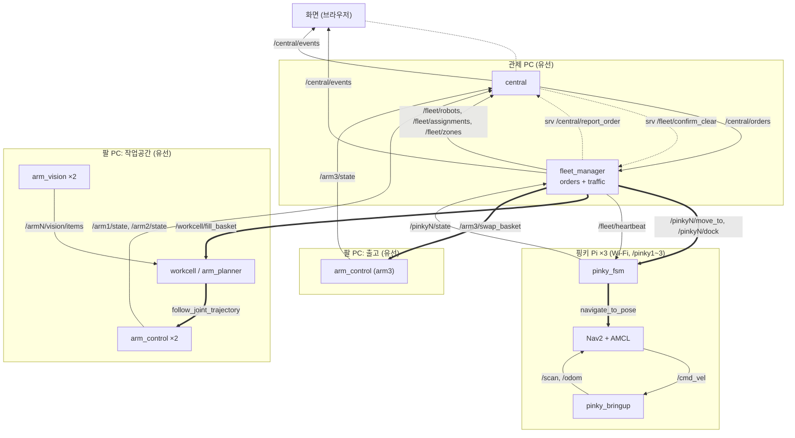

# GG (Give Gift)

심화 16기 2팀 GG 프로젝트 저장소입니다. 관제 PC, 핑키 3대(pinky1~3), 로봇팔 3대(작업공간 arm1·arm2, 출고 arm3)의 ROS 2 Jazzy 패키지를 둡니다. 핑키 제조사 패키지는 `iponic.repos`로 따로 받습니다.

## 폴더

```text
interfaces/fleet_interfaces/  msg·srv·action, contract.yaml(인터페이스 원본)
config/                       로봇 목록
pc/                           관제 PC: central, fleet_core, fleet_manager
pinky/                        핑키 Pi: pinky_fsm, pinky_dock, pinky_nav_config
arm/                          팔 PC: arm_control, arm_vision
sim/                          시험: fake_robots, fleet_gz_sim
bringup/iponic_bringup/       장치별 launch
tools/, scripts/              시험 도구, 계약 검사
docs/                         빌드·실행 규칙, 관제가 주고받는 것
```

## 연결



실선은 토픽, 점선은 서비스(화면과 central 사이는 ROS 밖), 굵은 선은 액션.

## 인터페이스

원본은 `interfaces/fleet_interfaces/contract.yaml`. `{pinky}`는 pinky1~3, `{arm}`은 arm1~3.

토픽

| 이름 | 타입 | QoS | 방향 |
|---|---|---|---|
| `/central/orders` | `OrderBoard` | LATCHED | central → FMS |
| `/central/events` | `FleetEvent` | EVENT | FMS·central → 화면 |
| `/fleet/robots` | `RobotStatusArray` | LATCHED | FMS → central |
| `/fleet/assignments` | `AssignmentArray` | LATCHED | FMS → central |
| `/fleet/zones` | `ZoneStateArray` | LATCHED | FMS → central |
| `/fleet/heartbeat` | `std_msgs/Header` | STATE | FMS → 핑키 |
| `/{pinky}/state` | `RobotState` | STATE | 핑키 → FMS |
| `/{arm}/state` | `ArmState` | STATE | 팔 → central |
| `/{arm}/vision/items` (arm1, arm2) | `ItemArray` | LATCHED | 비전 → 작업공간 서버 |

액션

| 이름 | 타입 | 방향 |
|---|---|---|
| `/{pinky}/move_to` | `MoveTo` | FMS → 핑키 |
| `/{pinky}/dock` | `Dock` | FMS → 핑키 |
| `/workcell/fill_basket` | `FillBasket` | FMS → 작업공간 서버(arm1·arm2) |
| `/arm3/swap_basket` | `SwapBasket` | FMS → arm3 |
| `/{pinky}/navigate_to_pose` | `nav2_msgs/NavigateToPose` | 핑키 안(`pinky_fsm` → Nav2) |

서비스

| 이름 | 타입 | 방향 |
|---|---|---|
| `/central/submit_order` | `SubmitOrder` | 화면 → central |
| `/central/set_run_mode` | `SetRunMode` | 화면 → central |
| `/central/report_order` | `ReportOrder` | FMS → central |
| `/fleet/confirm_clear` | `ConfirmClear` | central → FMS |

QoS

| 이름 | 신뢰성 | 지속성 | 깊이 |
|---|---|---|---|
| STATE | best_effort | volatile | 5 |
| LATCHED | reliable | transient_local | 1 |
| EVENT | reliable | volatile | 50 |

영상은 ROS로 보내지 않습니다. 집기용 사진은 HTTP 스냅샷 한 장, 화면용은 MJPEG over HTTP입니다.
