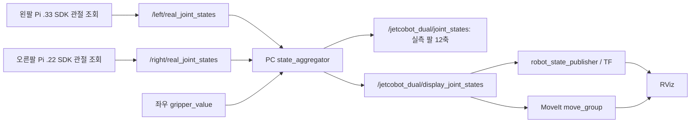
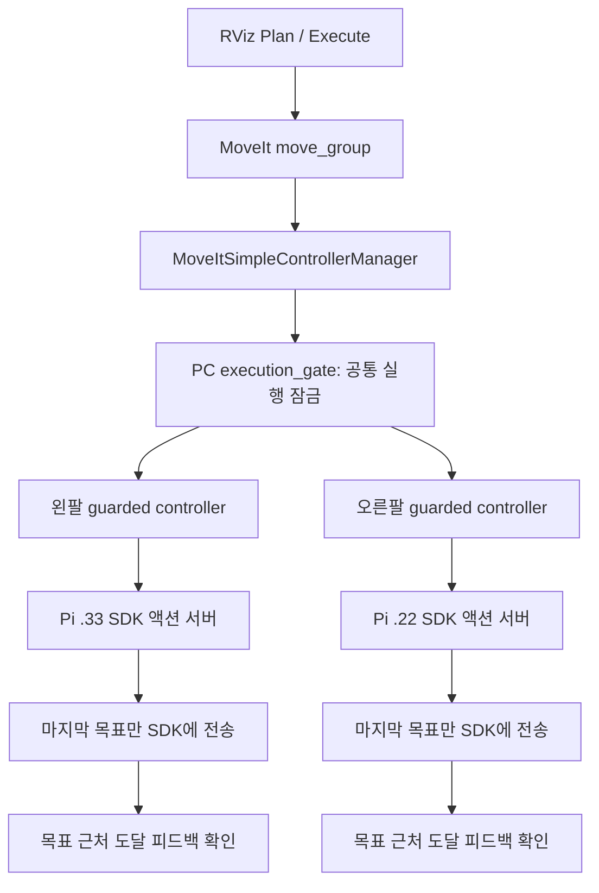

# 11.6일 MoveIt 연동 방식과 현재 한계

작성일: 2026-11-06  
작업 공간: `/home/ane/pinky_ws`  
실제 로봇용 패키지: `src/jetcobot_dual_real`  
기준: 작성 시점의 로컬 코드, 사용자 실물 확인, 소프트웨어 검증 결과.

## 1. 목표와 현재 결론

목표는 **동일한 JetCobot 두 대가 각자 주어진 물체를 집어 하나의 공용 바구니에 넣는 작업**이다.
단순히 두 팔이 RViz에 표시되는 것뿐 아니라, 두 팔과 운반 물체가 충돌하지 않도록
작업 구간과 이동 시점을 조정해야 한다.

현재 구현은 **두 로봇의 실제 상태를 한 MoveIt 모델에 표시하고, 각 팔과 그리퍼의
최종 목표를 SDK로 실행하는 시험용 연결**이다. 양팔의 시간 동기화된 궤적 실행,
공유 바구니 작업 스케줄러, 실제 경로 추종에 기반한 무충돌 동작은 구현·검증되지 않았다.

가장 중요한 한계는 다음과 같다.

> MoveIt이 계산한 관절 궤적 전체를 실제 로봇이 실행하는 것이 아니라,
> 궤적의 마지막 관절 목표만 SDK로 한 번 전달한다.
> 따라서 RViz의 회피 경로와 실행 시간이 실물에서 재현된다고 볼 수 없다.

**5° 제한이나 실행 잠금을 제거하는 것만으로 목표 작업이 완성되지는 않는다.**

## 2. 장비와 좌표계

| 구분 | 왼팔 | 오른팔 |
|---|---|---|
| 이름 | `left`, 새 로봇 | `right`, 기존 로봇 |
| Raspberry Pi IP | `192.168.0.33` | `192.168.0.22` |
| 모델 관절 이름 | `left_1_Joint` … `left_6_Joint` | `right_1_Joint` … `right_6_Joint` |
| 베이스 프레임 | `left_base_link` | `right_base_link` |
| 손목 프레임 | `left_6_Link` | `right_6_Link` |
| 도구 프레임 | `left_TCP` | `right_TCP` |
| `world` 기준 베이스 위치 [m] | `(0, +0.30, 0)` | `(0, 0, 0)` |
| 베이스 방향 | 오른팔과 같은 방향 | 원점 기준 방향 |
| 카메라 송신 목적지 포트 | UDP `5001` | UDP `5000` |

- `world`는 **기존 로봇 .22의 베이스**를 원점으로 잡았다.
- 처음에 first/second와 left/right를 혼용했으나, 최종 대응은 **left=.33, right=.22**다.
- 두 베이스의 +Y 30cm 간격과 같은 방향은 사용자 설명을 반영한 설정이다.
  정밀한 실측·외부 보정이 끝났다는 뜻은 아니다.
- 작성 시 확인한 노트북 IP는 `192.168.0.15`다. DHCP 변경 시 카메라 송신 host도 바꿔야 한다.
- 세 장비는 ROS 2 Jazzy 환경, `ROS_DOMAIN_ID=42`, SUBNET 검색으로 통신한다.
- 두 Pi에서 사용자가 조회한 버전은 `pymycobot 4.0.7`, 시스템 펌웨어 `6.5`였다.
  끝단 펌웨어의 별도 버전은 조회 코드에서 확인하지 못했다.
- SSH는 Pi에서 프로그램을 실행·관리하는 통로다. 관절 상태와 실행 요청은 SSH를
  경유해 전달하는 방식이 아니라 **ROS 2 네트워크 통신**으로 전달된다.

좌표 구조:

```text
world = 기존 로봇 .22의 베이스 기준
 ├─ right_base_link : (0, 0, 0)
 │   └─ right_1_Joint … right_6_Link → right_TCP / 그리퍼
 └─ left_base_link  : (0, +0.30, 0)
     └─ left_1_Joint … left_6_Link → left_TCP / 그리퍼
```

## 3. 모델과 MoveIt 구성

기존 Gazebo 듀얼암 모델을 읽어 실제 로봇용 모델을 **런치 시 메모리에서 생성**한다.
원본 Gazebo URDF/SRDF나 기존 단일 로봇 도구를 이번 패키지가 덮어쓰는 구조는 아니다.

입력 모델:

- `jetcobot_gazebo/urdf/dual/jetcobot_dual.urdf`
- `jetcobot_gazebo/config/dual/jetcobot_dual.srdf`
- `jetcobot_gazebo/config/dual/kinematics.yaml`

실제 모델 생성 시 수행하는 작업:

1. Gazebo 플러그인, `ros2_control`, transmission 태그 제거.
2. `config/layout.yaml`에 맞춰 두 베이스의 고정 변환 설정.
3. 양쪽 팔에 실제 관절 제한 적용.
4. 각 팔의 IK 끝단·end effector를 TCP에 맞추고, HOME 목표를 전 관절 0으로 구성.
5. 메시 경로를 설치된 패키지의 실제 파일 경로로 해결.
6. 팔 그룹에 KDL IK, 경로 계획에 OMPL RRTConnect 사용.

| 실제 관절 | 각도 범위 |
|---|---|
| 1 | −168° ~ +168° |
| 2 | −135° ~ +135° |
| 3 | −150° ~ +150° |
| 4 | −145° ~ +145° |
| 5 | −165° ~ +165° |
| 6 | −180° ~ +180° |

손목에 관한 주의점:

- Gazebo 듀얼 모델의 6번 관절에는 단일 원본 대비 기존 −45° 보정이 이미 반영돼 있다.
  추가 보정 `wrist_roll_adjust_deg`의 기본값은 0이다.
- 새 로봇은 같은 SDK 0°에서 그리퍼 실물 방향이 다른 현상이 있었고, 사용자가
  로봇 쪽 기준을 조정한 뒤 일치한다고 확인했다. 구체적인 저장 보정값은 이 문서에 없다.
- 로봇 영점 보정과 URDF 보정을 중복 적용하면 안 된다. 카메라 외부 보정도
  어떤 손목 프레임과 영점 기준에서 구했는지 맞춰야 한다.

## 4. 실제 관절 상태가 MoveIt에 들어오는 경로



Pi의 SDK 조회는 현재 실행 명령 기준 **초당 2회**다. 각 Pi의 상태 메시지 안에서는
원래 관절 이름 `1_Joint` … `6_Joint`를 유지한다. PC 통합 노드가 각 토픽의 출처에
따라 `left_` / `right_`를 붙여 공통 모델에 전달한다.

`state_aggregator`의 처리:

- 두 팔 상태가 모두 있어야 통합된 팔 상태를 발행한다.
- 수신 시각과 원본 ROS 타임스탬프의 오래됨을 검사한다. 기본 기준은 1.5초다.
- 중복·역행 타임스탬프, 잘못된 관절 이름, 비정상 수치는 거부한다.
- 통합 메시지는 두 원본 중 **더 오래된 측정 시각**을 사용한다.
  오래된 값을 현재 시각으로 다시 찍어 최신 측정처럼 만들지 않는다.
- 한쪽이 오래되면 통합 발행을 중단하고 `state_status`에 상태를 알린다.
- 그리퍼 값은 SDK 0~100을 모델 관절값으로 근사 변환한다. 실제 손가락 개구 폭이나
  파지력이 보정된 측정값은 아니다.

그리퍼 피드백 문제와 수정:

- 양쪽 Pi에서 타입 3을 명시한 조회가 `181`을 반환하는 현상이 관찰됐다.
- 종전에는 유효 그리퍼 값이 없을 때 PC가 0.535, 즉 모델의 열림 값을 대신 넣었다.
  이 때문에 실물은 닫혀 있어도 MoveIt이 OPEN 목표를 이미 만족했다고 판단했다.
- 현재는 기본값으로 열림을 발행하지 않는다. 누락·오래됨·잘못된 값은
  `unavailable`로 구분하고 해당 그리퍼 관절을 측정 상태에서 제외한다.
- Pi의 `gripper_type:=0`은 **SDK 조회 인자를 생략**한다는 설정이다.
  SDK에 타입 숫자 0을 전달하거나 하드웨어 설정을 바꾸는 명령은 아니다.
- 이는 기존 프로젝트의 인자 없는 setter/getter 사용 방식에 맞춘 것이다.
  181을 임의로 100으로 잘라서 열림으로 취급하지 않는다.
- 조회 오류는 −1을 발행해 이전 그리퍼 추정값도 무효화한다.

## 5. MoveIt 실행 요청이 실제 로봇에 전달되는 경로



### 5.1 표준 액션 메시지와 실제 실행 의미의 차이

MoveIt과 PC/Pi 사이에서는 `control_msgs/action/FollowJointTrajectory`를 사용한다.
따라서 MoveIt에서 표준 컨트롤러처럼 연결할 수 있지만, **이 메시지 타입을 사용한다는
사실만으로 구현체가 시간별 궤적을 추종하는 것은 아니다.**

현재 실행 경로에는 `ros2_control_node`의 실제 하드웨어 플러그인과
`JointTrajectoryController`가 없다. MoveIt의 컨트롤러 관리 플러그인은 액션 이름과
관절 목록을 연결하며, 실제 하드웨어 처리는 사용자 정의 Python SDK 브리지가 담당한다.

### 5.2 팔 실행

Pi의 `SDKGoalBridge.execute()`는 다음과 같이 동작한다.

1. 전달된 전체 궤적의 이름·범위·시작 자세·우회 여부 등을 검증한다.
2. `sdk_goal_target(points)`로 **마지막 관절 목표**를 추출한다.
3. 한 관절만 바뀌면 `send_angle(..., 10, _async=True)`를 한 번 호출한다.
4. 여러 관절이 바뀌면 `send_angles(..., 10, _async=True)`를 한 번 호출한다.
5. 이후 실제 관절값을 읽으며 목표 근처에 도달했는지 확인한다.

현재 의미를 의사 코드로 표현하면 다음과 같다.

```python
planned_points = moveit_trajectory.points
target = planned_points[-1].positions
sdk.send_angles(target_degrees, speed=10)  # 실제 코드는 단일 관절이면 send_angle
wait_until_measured_angles_near_target()
```

실행하지 않는 정보:

- MoveIt 중간 waypoint들의 실제 재생.
- 각 point의 `time_from_start`에 따른 시간 동기화.
- 계획된 속도·가속도 프로파일의 실제 추종.
- 양팔의 동일 시각 출발·도착 또는 동기화된 중간 위치.

시간 정보 일부는 입력 검증·대기 시간 산정에 사용하지만, 시간별 제어 목표로
재생하지는 않는다. 피드백의 `desired`도 그 순간의 계획 보간값이 아니라 최종 목표다.
SDK 속도 인자 10을 계획 궤적의 rad/s 제한과 같은 값으로 해석하면 안 된다.

기본 성공 조건은 관절 목표 오차 약 2° 이내 및 일정 시간의 안정된 피드백이다.
**이 성공은 목표 근처 도달 성공이며, MoveIt 경로 추종 성공이 아니다.**

`native_interpolation:=true`이면 SDK fresh mode를 0으로 설정하고 원래 모드를
복구 기록에 남긴다. 정상 종료 시 원래 모드를 복원한다. 이 native 보간도
MoveIt의 전체 waypoint와 타이밍을 실행한다는 뜻은 아니다.

### 5.3 액션 주소

| 구분 | 왼팔 .33 | 오른팔 .22 |
|---|---|---|
| PC 팔 컨트롤러 | `/jetcobot_dual/guarded_left_controller/follow_joint_trajectory` | `/jetcobot_dual/guarded_right_controller/follow_joint_trajectory` |
| Pi 팔 서버 | `/left/sdk_goal_controller/follow_joint_trajectory` | `/right/sdk_goal_controller/follow_joint_trajectory` |
| PC 그리퍼 컨트롤러 | `/jetcobot_dual/guarded_left_gripper_controller/follow_joint_trajectory` | `/jetcobot_dual/guarded_right_gripper_controller/follow_joint_trajectory` |
| Pi 그리퍼 서버 | `/left/gripper_group_controller/follow_joint_trajectory` | `/right/gripper_group_controller/follow_joint_trajectory` |

### 5.4 그리퍼 실행

MoveIt 그리퍼 그룹은 `gripper_left`, `gripper_right`다.
`open_left/open_right`는 모델 목표 +0.535, `closed_left/closed_right`는 −0.83이다.
Pi에서 이를 SDK 100=열기, 0=닫기로 변환해 `set_gripper_value(value, 50)`를 한 번 보낸다.

그리퍼도 궤적의 마지막 목표를 사용하고 MoveIt의 중간 시각·속도를 재생하지 않는다.
SDK 위치값과 정지 응답으로 완료를 확인하며, 파지력 센서나 물체 존재 감지를
구현한 것은 아니다. 물체 때문에 완전히 닫히지 않으면 최종 위치 성공 조건과
실제 파지 성공이 서로 다를 수 있다.

## 6. 현재 실행 모드와 제한

```bash
ros2 launch jetcobot_dual_real dual_real.launch.py execution_arm:=both
```

`both`의 의미는 **두 로봇의 컨트롤러를 함께 등록하고 양쪽 SDK 연결을 유지**한다는 것이다.
`arm_left`, `arm_right`를 바꿔 각 팔을 실행할 수 있지만 동시에 두 팔을 움직이지 않는다.

| 제한 | 적용 위치·의미 |
|---|---|
| 한 번에 요청 하나 | PC 공통 busy/fault 잠금. 팔·그리퍼·좌우 모두 공유 |
| 한 관절 시험 | PC에서 일반 팔 목표는 움직이는 관절 하나만 허용 |
| HOME 예외 | 모든 목표가 0° 근처 ±0.1°일 때 작은 다축 영점 잔차 보정 허용 |
| 관절별 최대 5° | PC 검증 및 Pi 실행 명령의 `max_move_deg:=5.0` |
| 궤적 구간 0.08rad/s | PC/Pi의 요청 궤적 검증. 실제 SDK 속도 측정·제어와는 별개 |
| 경로 우회·반전 제한 | SDK 목표 이동으로 재현하지 못할 계획은 거부. 통과해도 실제 경로 일치 보장은 없음 |
| 새 요청 및 팔 이동 상태 | 두 팔의 최근 측정 필요, 기본 1.5초 기준 |
| 진행 중인 그리퍼의 상태 공백 | 정지한 두 팔을 감시하며 최대 3초까지 허용. 팔 실행 기준은 그대로 1.5초 |
| 다른 팔 움직임 | 약 0.5° 초과 변화 시 취소 요청. 그리퍼 실행 중에는 같은 쪽 팔도 감시 |
| 그리퍼 요청 | 최근 5초 내 유효한 0~100 피드백 필요 |
| 실패 후 오류 잠금 | 후속 실행 차단. 원인·실제 정지 확인 후 PC 런치 재시작 필요 |

실행 모드에서는 `both_arms` 그룹을 제거한다. 하나의 양팔 궤적이 두 컨트롤러로
분리돼 한쪽만 먼저 움직이는 상황을 피하기 위해서다. 계획 전용 모드에서는
`both_arms`를 사용할 수 있고, 합성 상태로 양팔 계획 생성까지 확인했다.

Pi 자체에도 현재 팔/그리퍼 중복 요청을 막는 busy 검사가 있다. 하지만 외부 프로그램이
Pi의 SDK 액션을 직접 호출하면 PC 작업 관리 경로 밖이므로 별도 관리가 필요하다.

**취소 요청이나 SDK stop 호출은 물리적 정지 완료를 검증한 신호가 아니다.**
PC 종료·통신 단절 시 독립적인 하드웨어 정지 보장이 마련됐다고 간주하지 않는다.

## 7. 왜 공용 바구니 동시 작업에 아직 부족한가

### A. 계획한 경로와 실제 이동 경로가 같다는 보장이 없다

다른 팔이나 바구니 벽을 피하도록 중간 waypoint를 만들어도 SDK에 마지막 목표만
보내면 회피 동작이 재현된다고 볼 수 없다. 현재 우회 거부 검사는 이런 계획을 일부
차단하는 장치이지, 경로 추종 제어기를 대체하는 기능이 아니다.

### B. 다른 팔의 현재 자세를 검사하는 것과 동시 이동 조정은 다르다

현재 공통 모델은 다른 팔을 포함해 충돌을 검사할 수 있다. 그러나 한 팔을 계획할 때
반대 팔의 현재 자세를 사용하는 것만으로, 둘이 동시에 움직일 때의 시간별 충돌을
해결한 것은 아니다. 공통 모델 구성과 실행 시간 조정은 별도 문제다.

### C. 전체 작업 순서를 관리하는 로직이 없다

현재 gate는 요청 하나씩 통과시키는 중계기다. 물체 배정, 바구니 진입 예약,
파지 확인, 실패 복구, 놓인 물체의 장면 반영까지 수행하는 작업 스케줄러는 아니다.
실행 잠금을 없애면 이 기능들이 생기는 것이 아니라 동시 명령만 가능해진다.

### D. 작업 환경 모델과 인식·보정이 부족하다

- 실제 테이블, 바구니 벽·높이, 물체를 Planning Scene에 넣는 작업이 필요하다.
- 현재 런치에는 자동 Octomap 생성용 3D 센서가 설정돼 있지 않다.
- 집은 물체를 손끝의 attached object로 반영해야 운반 중 물체의 충돌도 검사할 수 있다.
- 베이스·TCP·그리퍼 형상·관절 영점 오차가 실제 충돌 여유에 미치는 영향을 확인해야 한다.
- 두 카메라 영상 수신만으로 물체의 신뢰할 수 있는 3D 파지 자세가 얻어지는 것은 아니다.

### E. 상태 갱신·추종·파지 성능의 정량 검증이 없다

현재 2Hz 피드백은 상태 표시와 초기 목표 도달 확인에는 사용했지만, 동시 동작의
경로 오차 감시나 정지 거리 검증이 완료된 제어 주기는 아니다. 실제 적합성은
통신 지연·최악 공백·제어 응답을 측정해 판단해야 한다.

사용자는 로봇별 떨림 차이와 일부 이동 중 떨림을 관찰했다. 이 현상은 손목 좌표
보정과 구분해서 조사해야 하며, 영점 일치만으로 해결됐다고 단정할 수 없다.

## 8. 다음 기술 조사에서 우선 확인할 것

### 우선순위 1: 실제 궤적 실행을 가능한 것으로 만들기

다음 세 경로를 비교하되, JetCobot/현재 펌웨어에서 지원된다고 아직 가정하지 않는다.

| 후보 | 필요한 확인 | 주의점 |
|---|---|---|
| 제조사 네이티브 궤적 큐/시간 지정 실행 | waypoint·시간·속도 버퍼 지원, 보간 방식, 정지·취소·피드백 의미 | 단순 PTP 함수와 구분해야 함 |
| 사용자 정의 `FollowJointTrajectory` 드라이버 | 모든 point를 시간에 맞춰 실행하고 실제 오차 감시, 일관된 취소·결과 제공 | 액션 이름만 표준화하는 현재 방식에서 실행 의미까지 바꿔야 함 |
| `ros2_control` 하드웨어 인터페이스 + `joint_trajectory_controller` | 실제 SDK/통신의 주기적 read/write 지원 및 충분한 응답성 | 포장만 바꿔 마지막 목표를 보내면 기존 한계가 그대로 남음 |

MoveIt의 low-level controller 문서는 컨트롤러와 관절 목록을 어떻게 연결하는지
설명한다. 현재도 그 연결은 사용 중이다. 다음 과제는 그 아래 드라이버가 궤적을
실제로 수행하는 것이다. [MoveIt 컨트롤러 구성](https://moveit.picknik.ai/main/doc/examples/controller_configuration/controller_configuration_tutorial.html)

`joint_trajectory_controller`의 액션·명령/상태 인터페이스와 보간 동작을 검토하고,
하드웨어 플러그인의 read/write가 실제 장치에 맞는지 확인해야 한다.
[Jazzy Joint Trajectory Controller](https://control.ros.org/jazzy/doc/ros2_controllers/joint_trajectory_controller/doc/userdoc.html),
[Jazzy 하드웨어 컴포넌트 작성](https://control.ros.org/jazzy/doc/ros2_control/hardware_interface/doc/writing_new_hardware_component.html)

조사 질문:

1. 반복 SDK 목표가 기존 보간을 재시작하거나 큐에 쌓이는가?
2. 시간을 지정한 다축 waypoint 실행이 가능한가, 아니면 속도 인자 기반 PTP뿐인가?
3. 목표 전송·실측 읽기·그리퍼 조회를 함께 했을 때 각 요청의 최악 지연은 얼마인가?
4. 안전하게 운용 가능한 제어/피드백 주기는 얼마인가? 특정 Hz를 먼저 가정하지 않는다.
5. 취소·정지 시 실제 정지 시간과 이동 거리는 얼마인가?
6. 추종 오차가 커지거나 통신이 끊기면 장치 자체가 어떻게 동작하는가?
7. 펌웨어 업데이트나 다른 통신 인터페이스가 필요하다면 기존 기능과 복구 방법은 무엇인가?

### 우선순위 2: 공용 바구니를 사용하는 작업 관리자

첫 확장 목표는 **전체 작업은 병렬로 진행하되 바구니 진입은 한 팔씩** 처리하는 방식이다.
이는 아직 구현된 기능이 아니라 제안하는 다음 단계다.

```text
물체 배정 → 파지 후보 생성 → 접근 → 파지 확인 → 들어 올리기
→ 바구니 진입 허가 획득 → 운반·배치 → 후퇴 확인 → 허가 해제
```

- 공유 구역은 TCP 점만이 아니라 팔·그리퍼·운반 물체의 전체 이동 공간으로 판단한다.
- 허가는 고정 sleep이 아닌 실제 후퇴와 최신 피드백을 확인한 뒤 해제한다.
- 목표·물체가 바뀌면 Planning Scene을 갱신하고 계획을 다시 확인한다.
- 분리된 작업 구역에서의 병렬 동작도 실제 경로 실행이 검증된 뒤 허용한다.
- 바구니 주변까지 동시 동작이 필요하면 양팔의 구성 공간과 시간을 함께 고려해야 한다.

MoveIt Task Constructor는 접근·파지·들기·놓기 같은 단계를 구성하는 조사 후보다.
하지만 그 자체가 저수준 궤적 드라이버나 양팔 시간 동기화 문제를 해결하는 것은 아니다.
[MoveIt MTC 개념](https://moveit.picknik.ai/main/doc/concepts/moveit_task_constructor/moveit_task_constructor.html),
[MTC Pick-and-Place 예제](https://moveit.picknik.ai/main/doc/tutorials/pick_and_place_with_moveit_task_constructor/pick_and_place_with_moveit_task_constructor.html)

### 우선순위 3: 인식·좌표·충돌 장면 연결

필요한 좌표 변환은 다음과 같다. `T_A_B`는 B 좌표를 A 좌표로 바꾸는 행렬이다.

```text
p_world = T_world_base × T_base_wrist(q) × T_wrist_camera × p_camera
```

- 각 카메라의 내부 파라미터와 현재 해상도·초점 설정을 확인한다.
- 각 장착 상태의 hand-eye와 로봇별 영점 기준을 맞춘다.
- 단안 RGB 영상이면 픽셀만으로 3D점이 정해지지 않는다. 알려진 작업 평면·물체 크기,
  깊이 센서 또는 별도 3D 추정 중 적용할 방법을 정하고 오차를 검증한다.
- 바구니 위치와 물체 자세를 공통 world에 표현한다.
- 실제 잡은 물체를 attached object로, 내려놓은 물체를 world collision object로 갱신한다.

관련 공식 자료:
[Planning Scene](https://moveit.picknik.ai/main/doc/examples/planning_scene/planning_scene_tutorial.html),
[MoveIt 듀얼암 구성](https://moveit.picknik.ai/main/doc/examples/dual_arms/dual_arms_tutorial.html).

## 9. 카메라·hand-eye의 현재 상태

카메라는 각 Pi에서 H264/RTP를 노트북으로 송신한다. 현재 설정은
640×480, YUY2 입력, 30fps 요청, x264, UDP 전송이다. 공통 센서 노출 시각이
ROS 관절 측정과 동기화돼 있지는 않다. 수신 시각은 노출 시각과 다르다.

**영상 표시의 LEFT/RIGHT 라벨 주의:** `dual_camera_view.py`의 기본값은
left-port=5000, right-port=5001로 초기 first/second 순서를 유지한다.
최종 로봇 이름 left=.33 / right=.22와 맞춰 보려면 다음처럼 실행한다.

```bash
/usr/bin/python3 ~/camera_code/dual_camera_view.py --left-port 5001 --right-port 5000
```

단일 팔 hand-eye 후보 `manual02`의 저장 결과:

- `/home/ane/camera_code/handeye_capture/manual02/T_gripper_camera_unvalidated.npy`
- 카메라 optical → 당시 손목 프레임의 4×4 변환, 위치 단위 m.
- 51쌍 사용, 이미지별 재투영 RMSE 평균 약 0.412px.
- 고정 보드의 내부 산포 RMS 약 12.743mm, 2.509°.
- 내부 산포는 실제 파지 좌표 정확도 측정값과 다르며 독립 검증되지 않았다.
- 해당 파일의 단일 `real_robot/6_Link` 기준과 실제 로봇 식별·영점·장착 상태를
  대조하기 전 양쪽 카메라에 임의로 공용 적용하면 안 된다.

## 10. 확인된 것과 확인되지 않은 것

| 항목 | 증거와 범위 |
|---|---|
| 두 로봇 실제 관절 상태 수신 | 실제 토픽 수신과 사용자 RViz 확인 |
| 좌우 공통 모델·30cm 배치 | TF 확인 및 사용자 표시 확인. 정밀 베이스 외부 보정은 별도 |
| 두 카메라 영상 | 사용자 동시 수신 확인 |
| 실제 팔 SDK 목표 이동 | 사용자가 작은 시험 이동·복귀 성공 확인. 전 경로 추종 검증은 아님 |
| 실제 그리퍼 동작 | 사용자가 열기·닫기 문제 수정 후 성공 보고. 모든 조건의 반복 안정성·파지력은 미검증 |
| 좌우 실행 전달과 잠금 | 가짜 SDK 서버를 이용한 MoveIt Plan-and-Execute 검증 |
| 짧은 상태 지연 처리 | 합성 1.8초 공백 시험. 실제 최악 지연을 계측 완료한 것은 아님 |
| 현재 자동 테스트 | 최근 13개 pytest 통과 및 합성 양팔/그리퍼 실행 smoke test 통과 |
| 양팔 실제 동시 작업 | 실행 잠금으로 제한 중. 미검증 |
| 물체 자동 인식·파지·공용 바구니 작업 | 작업 파이프라인 미구현 |
| 충돌 없는 실제 경로 추종 | 현재 SDK 목표 전송 방식으로 보장하지 않음 |

그 외 관찰 사항:

- `move_group` 종료 중 segmentation fault가 소프트웨어 테스트에서 관찰됐다.
  계획·가짜 실행 성공과 종료 안정성은 구분해야 한다.
- SDK native mode 복구 기록이 남으면 복원 후 재실행하도록 되어 있다.
  기록 파일만 지워 우회하는 방법을 정상 복구로 취급하지 않는다.
- 현재 코드는 하드웨어 비상정지, 정지 완료 피드백, 정지 거리 기반 안전 여유를
  검증한 시스템이 아니다.

## 11. 관련 로컬 파일

| 파일 | 역할 |
|---|---|
| [dual_real.launch.py](jetcobot_dual_real/launch/dual_real.launch.py) | 모델·상태 통합·MoveIt·RViz·실행 gate 런치 |
| [layout.yaml](jetcobot_dual_real/config/layout.yaml) | 베이스 배치와 손목 추가 보정 |
| [model.py](jetcobot_dual_real/jetcobot_dual_real/model.py) | Gazebo 모델의 실제 로봇용 변환 |
| [state_aggregator.py](jetcobot_dual_real/jetcobot_dual_real/state_aggregator.py) | 양팔 측정 통합, 신선도, 그리퍼 추정값 처리 |
| [execution_gate.py](jetcobot_dual_real/jetcobot_dual_real/execution_gate.py) | 좌우 팔·그리퍼 액션 중계, 공통 잠금, 시험 제한 |
| [read_joint_states.py](jetcobot_dual_real/robot_bridge/read_joint_states.py) | Pi SDK 관절·그리퍼 조회와 상태 발행 |
| [sdk_goal_bridge.py](jetcobot_dual_real/robot_bridge/sdk_goal_bridge.py) | 최종 SDK 목표 실행과 도달 확인 |
| [trajectory_guard.py](jetcobot_dual_real/robot_bridge/trajectory_guard.py) | Pi 궤적·하드웨어 범위 검증 |
| [hardware_bridge.py](jetcobot_dual_real/robot_bridge/hardware_bridge.py) | 공통 브리지 기반 및 별도 샘플링 실행 코드 |
| [mode_lease.py](jetcobot_dual_real/robot_bridge/mode_lease.py) | SDK 모드 변경 기록·복구 |
| [restore_sdk_mode.py](jetcobot_dual_real/robot_bridge/restore_sdk_mode.py) | 비정상 종료 후 SDK 모드 복원 |
| [README.md](jetcobot_dual_real/README.md) | 복사·실행·그리퍼 설정 명령 |
| [VALIDATION.md](jetcobot_dual_real/VALIDATION.md) | 실제 관찰과 소프트웨어 검증의 상세 구분 |

`hardware_bridge.py`에 보간/샘플링 실행 코드가 존재하더라도 현재 진입점은
`sdk_goal_bridge.py`이며 SDKGoalBridge가 실행 메서드를 재정의한다.
따라서 파일에 보간 함수가 있다는 이유로 현재 로봇이 경로를 추종한다고 해석하면 안 된다.

## 12. 다음 조사·개발의 완료 기준

| 단계 | 결과물과 확인할 기준 |
|---|---|
| 1. 단일 팔 제어 경로 확정 | SDK/펌웨어 기능표, 실제 궤적 실행 방식, 취소·통신 단절 동작 정리 |
| 2. 추종 성능 측정 | 계획 q(t)와 실측 q(t), 시각 차이, 최대/RMS 오차, 지연·공백·정지 거리 기록 |
| 3. 좌표·장면 검증 | 두 베이스·TCP·카메라·바구니 실측 좌표와 충돌 형상 확인 |
| 4. 단일 팔 자동 작업 | 인식 → 접근 → 파지 확인 → 운반 → 놓기 → 후퇴를 재현 가능하게 실행 |
| 5. 두 팔 순차 공용 바구니 | 공유 구역 허가·후퇴 확인·실패 시 잠금 유지 구현 |
| 6. 분리 작업 구역 병렬화 | 경로·운반물·추종 오차를 포함한 구역 분리 검증 후 제한된 병렬 실행 |
| 7. 공유 구역 동시 동작 | 필요할 경우 양팔 경로와 시간을 함께 계획·실행·검증 |

외부 문서는 2026-11-06에 확인한 공식 자료다. MoveIt 링크 일부는 main/Rolling
문서이므로 실제 도입 시 현재 Jazzy 설치 버전과 API·브랜치 호환성을 확인해야 한다.
이 문서의 후보 기술은 조사 방향이며, 해당 JetCobot에서의 지원·성능을 보증하지 않는다.
