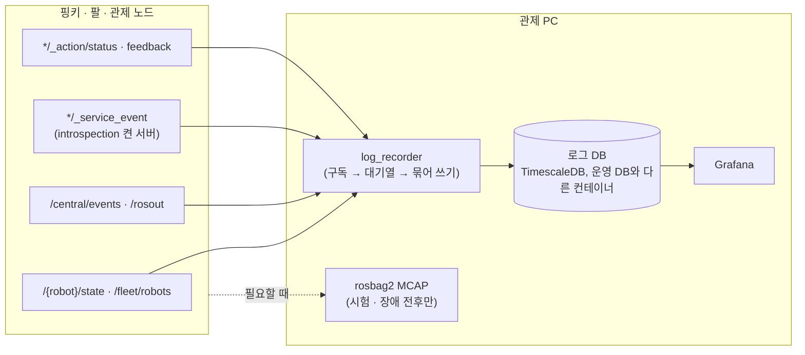

# 로봇 로그 기록 서비스 기술 조사

- 버전 v0.2 (2026-11-25) · 상태: 조사 초안에 검토 의견(맨 아래) 7건을 반영함, 팀 확인 전. 7장의 `LG-nn`은 모두 "제안"입니다. 확정 전에는 코드에 넣지 않습니다.
- 목적: [설계 검토 사항](설계_검토_사항.md) Q-22(로봇 상태 · 이벤트 로그 DB, 열림)에 답할 근거를 모읍니다. 로봇의 상태 · 이벤트를 ROS 2 토픽 · 서비스 · 액션으로 모아 **시계열 DB**에 쓰고, **개발과 장애 분석**에 씁니다.
- 기준 문서: [통신 규칙](통신_규칙.md) IR-31 · IR-55 · IR-57, 2장 QoS 표, [인터페이스 명세](인터페이스_명세.md) 3.5, [주문 DB 설계](../superpowers/specs/2026-11-18-order-db-design.md) 1절 "하지 않는 것"(FMS Log는 InfluxDB로 따로), [디스커버리 서버 안내](디스커버리_서버_안내.md), [서비스 브리지 기술 조사](서비스_브리지_기술_조사.md) 4.5(구조화 로그 · 묶는 번호)

## 1. 지금 정해진 것 (출발점)

| 구분 | 내용 | 근거 |
|---|---|---|
| 나눔 | 로봇 상태 · 이벤트 로그는 운영 DB(웹이 주인)와 **나눈 로그 DB**에 쓴다 | IR-55 (2026-11-25) |
| 쓰임 | 개발과 장애 분석. 로그 DB 값으로 운영 상태를 정하거나 바꾸지 않는다 | IR-55 · IR-57 |
| 종류 | 시계열 DB (이번 요청). 주문 DB 설계(11-18)는 "InfluxDB"로 적었으나 Q-22 1번은 아직 열림 | 주문 DB 설계 1절, Q-22 |
| 놓치면 안 되는 알림 | WARN 이상은 지금처럼 `ReportEvent` → 브리지 → 운영 DB `alert`. 로그 DB는 이 길을 대신하지 않는다 | IR-10 · IR-12, W-24 |
| 받는 쪽이 없는 토픽 | `/central/events`(`FleetEvent`, EVENT QoS)는 "유지 (기록용)"인데 지금 받는 쪽이 없다. 로그 DB가 받는 쪽이 된다 | 명세 3.5, Q-22 3번 |
| 망 | 디스커버리 서버(도메인 6, `rmw_fastrtps_cpp`), 설정은 `tools/net/net_ds.sh` 한 곳 | IR-81 · IR-82 |
| 운영 DB | PostgreSQL 16 (docker compose, `psycopg` 사용) | 개발 규칙, `design/db/compose.yaml` |

## 2. 조사 질문

| 번호 | 질문 | 결과 |
|---|---|---|
| L-1 | 토픽 · 서비스 · 액션을 Jazzy에서 어떻게 빠짐없이, 로봇을 막지 않고 받나 | 4.1 |
| L-2 | 시계열 DB는 무엇을 쓰나 (InfluxDB 2 · InfluxDB 3 Core · TimescaleDB · QuestDB) | 4.2 |
| L-3 | rosbag2(MCAP)와는 어떻게 나누나 | 4.3 |
| L-4 | 어떤 모양으로 저장하나 (표 · 칸 · 묶는 번호 · 시간) | 4.4 |
| L-5 | 양은 얼마나 되고 얼마나 두나 | 4.5 |
| L-6 | 무엇으로 보나 (개발 · 장애 분석 화면) | 4.6 |
| L-7 | GitHub 등에 가져다 쓸 수 있는 로그 기록 도구 · 서비스가 있나 | 4.7 |
| L-8 | 무엇부터 기록하나, 액션 · 팔 기록은 무엇으로 잇나 (검토 의견 반영) | 4.8 · 4.9 |

## 3. 방법

ROS 2 Jazzy 공식 문서(서비스 introspection, rosbag2), Kilted 출시 노트(액션 introspection), 각 DB 공식 문서 · 라이선스 페이지를 확인했습니다. 우리 인터페이스 목록(명세 3장)과 QoS 표(통신 규칙 2장)에 대 보고 양을 어림했습니다. 실측은 하지 않았습니다(6장 "확인 필요").

## 4. 조사 결과

### 4.1 L-1 ROS 2에서 모으기

| 대상 | Jazzy에서 받는 방법 | 근거 | 우리에게는 |
|---|---|---|---|
| 토픽 | 일반 구독. 타입 이름을 알면 `rosidl_runtime_py.utilities.get_message()`로 불러 `message_to_ordereddict()`로 바꾸므로 타입마다 코드를 쓰지 않아도 된다. `get_topic_names_and_types()`로 타입이 보이기를 기다리는 방식은 디스커버리 서버의 보통 client에서 구독이 생기기 전까지 토픽이 안 보일 수 있어 쓰지 않는다 | rclpy · rosidl_runtime_py, [Fast DDS Discovery Server](https://fast-dds.docs.eprosima.com/en/2.14.x/fastdds/discovery/discovery_server.html) | **이름 · 타입 · QoS는 contract에서 읽는다(IR-01).** 기록 설정 파일에는 contract의 `key` 중 무엇을 모을지만 적는다. 대상은 4.8 |
| 토픽 QoS | 받는 쪽 QoS가 보내는 쪽과 맞아야 한다. reliable 발행은 best_effort로도 받지만, best_effort 발행을 reliable로 받으면 연결되지 않는다. LATCHED는 transient_local로 받아야 켤 때 지금 값을 받는다 | [ROS 2 QoS 안내](ROS2_QoS_통신_안내.md) | 통신 규칙 2장 표 그대로: STATE는 best_effort, EVENT는 reliable depth 50, LATCHED는 reliable · transient_local depth 1 |
| 서비스 | **서비스 introspection** (Jazzy에 있음). 서버 · 클라이언트가 `configure_introspection()`을 켜면 `<서비스>/_service_event` 토픽(`service_msgs/ServiceEventInfo` + 요청 · 응답 내용)이 나온다. 사건 종류는 REQUEST_SENT · REQUEST_RECEIVED · RESPONSE_SENT · RESPONSE_RECEIVED, 순번 · 클라이언트 gid · 시각이 붙는다. 기본은 꺼짐. 켜는 단계는 끔 · 메타데이터만 · 내용까지 | [Jazzy Service Introspection](https://docs.ros.org/en/jazzy/Tutorials/Demos/Service-Introspection.html) | 서버 쪽에서 켬. 평소는 **메타데이터만**(본문 없음 → `request_id` · `trip_id`는 얻지 못함), 분석에 필요한 서비스만 내용까지 켠다. 서버 쪽 `REQUEST_RECEIVED` → `RESPONSE_SENT`는 **서버 처리 시간**일 뿐이고, 호출자가 응답을 받았는지 · 시간 초과 뒤 다시 보냈는지는 **호출자 구조화 로그**(서비스 브리지 조사 4.5)에서 본다. ROS 호출 한 번은 서비스 이름 · `client_gid` · `sequence_number`로, 같은 요청의 여러 시도는 `request_id`로 묶는다. 튜토리얼 데모처럼 `service_configure_introspection` 매개변수로 켜고 끈다 |
| 액션 | **Jazzy에는 액션 introspection이 없다** (Kilted에서 추가, `ros2 action echo`). Jazzy에서는 숨은 토픽 `/<액션>/_action/status`(`action_msgs/GoalStatusArray`)와 `/<액션>/_action/feedback`을 구독할 수 있다. goal 내용 · result는 숨은 서비스라 이 방법으로는 안 보인다 | [Kilted 출시 노트](https://docs.ros.org/en/kilted/Releases/Release-Kilted-Kaiju.html), [Kilted Action Introspection](https://docs.ros.org/en/kilted/Tutorials/Demos/Action-Introspection.html) | status · feedback은 기록 노드가 받는다. status에는 ROS goal UUID만 있어 `trip_id`와 잇는 키가 따로 필요하다. 지금 `FleetEvent`는 `level` · `source` · `code` · `detail` · `stamp`뿐이라 `goal_id` · `trip_id`를 칸으로 낼 수 없고, fleet 안의 goal 번호와 ROS UUID도 다르다. **키와 전달 형식은 정한 뒤 붙인다 (4.9, LG-09)** |
| rosout | 모든 노드의 로그가 `/rosout`(`rcl_interfaces/Log`)으로도 나간다 | ROS 2 About-Logging | WARN 이상만 받음. 노드 로그 파일을 모으지 않아도 장애 시점 메시지를 함께 볼 수 있다 |
| 디스커버리 서버 | 디스커버리 서버의 보통 client는 자기와 맞는 끝점만 안다. 정해진 토픽을 구독하는 데는 문제없지만, 기록 노드가 "있는 토픽을 모두 찾기"를 하려면 **super client**여야 한다 | Fast DDS Discovery Server 문서, [디스커버리 서버 안내](디스커버리_서버_안내.md) | 대상은 contract에서 정해 구독하므로 찾기가 필요 없다. 기록 노드는 운영과 같은 **보통 client**로 띄우고, 기록 노드를 먼저 띄운 뒤 발행 노드를 켜는 순서도 시험한다(C-1 · C-2). super client는 쓰지 않는다 |

**로봇을 막지 않기 (IR-31):** 구독 콜백은 받은 메시지를 메모리에 넣기만 하고, DB 쓰기는 따로 있는 쓰기 스레드가 묶어서(예: 0.5초 또는 500줄마다) 한 번에 씁니다. 기록 노드가 죽어도 로봇 · 관제는 그대로 돕니다(로그는 운영에 쓰지 않으므로). DB가 느리거나 멈췄을 때는 종류별로 다르게 다룹니다.

| 종류 | 담는 곳 | 넘칠 때 |
|---|---|---|
| 상태 (STATE · LATCHED) | 로봇 · 토픽별 **최신 값 한 칸** + 바뀐 값 짧은 대기열 | 같은 로봇 · 토픽의 중간 값만 합침. 다른 로봇 · 사건을 밀어내지 않음 |
| 사건 · 액션 끝 (`/central/events`, status의 끝 상태) | **따로 상한을 둔 대기열** | 상한을 넘으면 버리되, 상태보다 늦게 버림 |
| 피드백 · 서비스 메타데이터 | 따로 상한을 둔 대기열 | 먼저 버림 |

버린 수는 **DB 밖에도** 남깁니다(기록 노드의 로컬 로그 · `/rosout` · 지표). DB가 돌아오면 끊긴 구간(시작 · 끝 시각)과 종류별 버린 수를 `event_log`에 한 줄로 씁니다.

**시간:** 보낸 쪽 시각(`ts`)은 `header.stamp`, `FleetEvent.stamp`, 서비스 사건의 `info.stamp`, `SystemMode.stamp` 순으로 있는 것을 읽습니다. 없거나 0 · 비정상이면 받은 시각으로 대신하고, 어느 것을 썼는지 `ts_source`(`header` · `msg_stamp` · `service_info` · `recv`)로 남깁니다. 받은 시각(`recv_ts`)은 늘 함께 남깁니다. `recv_ts - ts`에는 전송 · 처리 지연도 들어가므로 이것만으로 시계 차이를 판단하지 않고 `chronyc tracking` 결과와 함께 봅니다(IR-42, C-4).

### 4.2 L-2 시계열 DB 고르기

| | TimescaleDB (PostgreSQL 확장) | InfluxDB 2.x OSS | InfluxDB 3 Core | QuestDB |
|---|---|---|---|---|
| 질의 | SQL 그대로 (조인 · JSONB) | Flux · InfluxQL | SQL · InfluxQL | SQL (일부 확장) |
| 오래된 데이터 질의 | 제한 없음 | 제한 없음 | **질의 한 번이 약 72시간 범위로 묶임** (Parquet 파일 432개 기본 한도, 설정으로 늘릴 수는 있음). 더 긴 질의는 Enterprise 쪽으로 안내 | 제한 없음 |
| 보관 · 압축 | `add_retention_policy` · `add_compression_policy` (압축은 Community 판, Apache 판에는 없음) | 버킷 보관 기간 | DB 만들 때 보관 기간 지정, 나중에 못 바꿈 | 파티션 지우기 |
| 라이선스 | Community 판은 TSL: DB를 호스팅 서비스로 팔지 않으면 무료 | MIT | MIT/Apache 2 | Apache 2 |
| 우리와 맞는 점 | 이미 PostgreSQL 16 · `psycopg`를 씀. 운영 DB의 `trip_id` · `request_id`와 같은 SQL로 대 볼 수 있음. 메시지 내용을 JSONB로 통째 담기 쉬움 | 지표(숫자) 위주 저장이 쉽고 Grafana와 잘 맞음. 문자열 · 중첩 메시지는 칸을 펴야 함 | 새 엔진이라 사례가 적고, 장애 분석에서 "지난주 같은 증상" 비교가 72시간 한도에 걸림 | 넣기가 매우 빠르지만 팀에 익숙한 사람이 없음 |
| 근거 | [Tiger Data 라이선스](https://www.tigerdata.com/legal/licenses) | InfluxData 문서 | [3 Core 질의](https://docs.influxdata.com/influxdb3/core/get-started/query/), [3 Core 보관](https://docs.influxdata.com/influxdb3/core/reference/internals/data-retention/) | QuestDB 문서 |

**판단:** 우리 양(4.5)은 어떤 시계열 DB에도 아주 작습니다. 그래서 고르는 기준은 성능이 아니라 **다루기 쉬움 · 운영 DB와 같이 보기 · 오래된 기록 질의**입니다. 이 셋에서 **TimescaleDB를 운영 DB와 다른 컨테이너(다른 인스턴스)로** 두는 안이 가장 낫습니다. 다른 인스턴스로 두면 IR-55의 "나눔"을 지키면서 기술은 하나로 유지됩니다. InfluxDB를 고른다면 3 Core가 아니라 **2.x**를 권합니다(72시간 한도). 주문 DB 설계 1절의 "InfluxDB" 문구와 다르므로 팀이 정합니다(LG-01).

### 4.3 L-3 rosbag2(MCAP)와 나누기

| | 로그 DB | rosbag2 (MCAP) |
|---|---|---|
| 담는 것 | 상태 · 사건 · 서비스 호출 · 액션 상태 (사람이 묻는 값) | 원래 메시지 그대로 (`/scan` · `/odom` · `/tf` · 카메라 등 빠르고 큰 것) |
| 묻는 방법 | "pinky2가 지난 1시간 동안 ERROR였던 때", "trip T-0412의 모든 기록" | 시간 구간을 다시 틀어 보기 (`ros2 bag play`, Foxglove · RViz) |
| Jazzy 지원 | — | MCAP이 기본 저장 형식. `ros2 bag record --all-services`로 서비스도 녹화(서비스 introspection을 켠 서버만) |
| 늘 켜 둠 | 예 | 아니오. 시험 · 재현 때, 또는 장애 전후 구간만 (아래) |

**장애 전후 bag:**
- **장애 전 구간**은 장애보다 먼저 스냅샷 녹화기(`--snapshot-mode`)가 돌고 있어야 얻습니다. Jazzy 스냅샷은 최근 메시지를 **바이트 상한**(`--max-cache-size`)이 있는 메모리에 둡니다. 시간이 아니라 크기 상한이므로 대상 토픽과 상한을 정한 뒤 실제로 몇 초를 담는지 잽니다(C-10).
- **장애 후 구간**은 스냅샷 저장 시점을 늦추거나(예: 장애 사건 뒤 N초에 저장), 저장과 함께 정해진 시간 동안 보통 녹화를 따로 켭니다.
- bag 재생은 IR-81의 혼자 하는 시험 환경(다른 도메인 · 서버 없음)에서만 합니다. 실물 망에서 틀면 진짜 노드가 받습니다.

근거: [rosbag2 Jazzy 스냅샷 모드](https://github.com/ros2/rosbag2/blob/jazzy/README.md#snapshot-mode), [Jazzy 녹화 · 재생 튜토리얼](https://docs.ros.org/en/jazzy/Tutorials/Beginner-CLI-Tools/Recording-And-Playing-Back-Data/Recording-And-Playing-Back-Data.html), [rosbag2_storage_mcap](https://docs.ros.org/en/jazzy/p/rosbag2_storage_mcap/), [ROSCon 2024 Jazzy rosbag2](https://roscon.ros.org/2024/talks/Jazzy_Jalisco_rosbag2_updates_and_new_features.pdf).

로그 DB에는 bag 파일 이름과 시간 구간을 한 줄 사건으로 남겨, DB에서 찾은 시점의 bag을 바로 열 수 있게 합니다.

### 4.4 L-4 저장 모양 (TimescaleDB 안)

모든 표는 `ts` 기준 hypertable입니다. 자주 묻는 칸만 펴고 나머지는 `data JSONB`에 메시지 통째로 둡니다. 메시지 칸이 바뀌어도 표를 고치지 않아도 됩니다.

| 표 | 받는 곳 | 펴는 칸 (공통: `ts` · `ts_source` · `recv_ts` · `system_mode` · `data`) |
|---|---|---|
| `robot_state` | `/{pode}/state` · `/fleet/robots` (뒤에 `/{arm}/state`, 4.8) | `robot` · `topic` · `boot_id` · `mode` · `state` · `lock` · `detail` · `x` · `y` · `yaw` · `battery` |
| `event_log` | `/central/events` · `/system/mode` 바뀜 · 기록 노드 자신의 사건(시작 · 끊긴 구간과 버림 수 · bag 저장) (뒤에 `/rosout` WARN 이상) | `source` · `level` · `code`(contract 사유 코드, IR-05). `trip_id` · `request_id` · `robot`은 `FleetEvent`에 칸이 없으므로 **비워 둠** (4.9에서 형식이 정해지면 채움) |
| `service_call` (2단계) | `*/_service_event` | `service` · `event_type` · `client_gid` · `sequence_number` · `info_stamp`. 내용까지 켠 서비스만 `request_id` · `trip_id` · `accepted` |
| `action_log` (3단계) | `*/_action/status` · `*/_action/feedback` (+ 4.9의 goal 보냄 · 결과 사건) | `action` · `goal_uuid` · `status` · `robot`. `trip_id` · `attempt`는 4.9 결정 뒤 |

- **묶는 번호:** 서비스 브리지 조사 4.5와 같은 이름 `request_id` · `trip_id`를 씁니다. 메시지에 그 칸이 **있을 때만** 기록 노드가 꺼내 폅니다(정의를 바꾸지 않음). contract 0.7 메시지로 바로 펼 수 있는 것은 `RobotStatus` · `Assignment` · `Order`의 `order_id`뿐이고(`request_id` 칸이 있는 토픽 메시지는 없음), "trip 하나를 처음부터 끝까지 한 질의로" 보려면 4.9의 키가 정해져야 합니다.
- **`system_mode`:** `/system/mode`(`SystemMode.mode`, `NORMAL` · `TEST`) 값을 기록 노드가 마지막으로 받은 값으로 채웁니다. 처음 받기 전의 기록은 `UNKNOWN`. (`run_mode`는 주문판 `OrderBoard`의 `RUN` · `PAUSE` · `STOP`이라 쓰지 않습니다.) 운영 DB는 시험 DB를 따로 두지만(주문 DB 설계 5절), 로그는 같은 표에 두고 걸러 보는 편이 장애 비교에 낫습니다(LG-05, Q-22 4번).
- **상태 거르기:** STATE 토픽(초당 5번 등)은 **값이 바뀔 때 + 1초마다 한 번**만 씁니다(위치는 일정 거리 이상 움직일 때). 원래 빈도가 필요하면 bag을 씁니다(LG-04).

### 4.5 L-5 양과 보관

어림(실측 전): 상태 토픽 Pode 3 + 팔 3 + `/fleet/robots` = 7개. 거르기 뒤 한 개당 초당 약 1줄 → 초당 7줄, 사건 · 서비스 · 액션을 넉넉히 초당 20줄로 잡으면 **하루 약 230만 줄**. 한 줄 1KB(JSONB)로 잡아도 하루 약 2.3GB, 압축 뒤 보통 몇 분의 일로 줄어듭니다. 관제 PC 한 대 디스크로 충분하고, 초당 수천 줄을 받는 TimescaleDB · InfluxDB 어느 쪽에도 부하가 되지 않습니다.

다만 하루 2.3GB를 30일 두면 압축 전 본문만 약 **69GB**입니다. 어림에는 상태가 바뀔 때마다 바로 쓰는 경우와 피드백이 몰리는 경우가 빠져 있으므로, 대기열 최대 크기 · 버린 수 · 디스크 사용량을 실제로 잽니다(C-3 · C-8).

보관(임시 값, LG-06): 1일 지난 덩어리는 압축, **30일** 지나면 지움. 장애로 남길 구간은 지우기 전에 CSV · bag으로 따로 꺼냅니다.

**배포:** `design/db/compose.yaml`은 데이터를 `tmpfs`에 두는 시험용이라 로그 DB에 그대로 쓰지 않습니다. 로그 DB는 **영속 볼륨**을 쓰고, 컨테이너를 다시 만들어도 기록이 남는지 확인합니다. 컨테이너를 나눠도 관제 PC의 CPU · 메모리 · 디스크는 fleet · 운영 DB와 같이 쓰므로, 압축 · 지우기 작업과 지난 기록 질의를 돌리는 동안 fleet · 운영 DB 응답 시간도 함께 잽니다. TimescaleDB의 효과는 확장 없는 PostgreSQL 16 인스턴스를 기준으로 비교합니다(C-9).

### 4.6 L-6 보는 방법

| 도구 | 쓰임 | 비고 |
|---|---|---|
| Grafana | 로봇별 상태 시간 막대(state timeline), 사건 목록, 서비스 응답 시간 · 실패 수, 배터리 · 위치 그래프 | PostgreSQL(TimescaleDB) · InfluxDB 데이터 원본 모두 기본 제공. docker compose에 같이 띄움 |
| `psql` · SQL 파일 | 장애 분석 정해진 질의 (trip 하나 따라가기, 장애 전후 1분 모든 기록) | `tools/log/` 같은 곳에 질의 모음 |
| Foxglove · RViz | bag 다시 보기 | 4.3 |

관리자 화면(웹)에 붙일지는 Q-22 5번입니다. 붙이더라도 보기만 하고 운영 판단에는 쓰지 않습니다(IR-55).

### 4.7 L-7 가져다 쓸 수 있는 도구 · 서비스

GitHub · ROS Discourse · ROS Index에서 찾았습니다. **"토픽 · 서비스 · 액션을 받아 시계열 DB에 쓰는" 일을 그대로 맡길 만큼 자리 잡은 공개 패키지는 찾지 못했습니다.** 있는 것은 대부분 개인 · 초기 프로젝트이거나, 일부(지표 · 노드 로그 · bag 업로드)만 맡습니다. 성숙도(마지막 커밋, Jazzy 빌드)는 쓰기 전에 다시 확인합니다(C-7).

**가. ROS 2 → 시계열 DB 다리 (우리 기록 노드와 같은 일)**

| 이름 | 하는 일 | 상태 · 판단 | 링크 |
|---|---|---|---|
| ros2-timescaledb-bridge | 토픽을 구독해 TimescaleDB에 바로 씀 (Jazzy · Python, `/joint_states` · `/cmd_vel`부터) | 작성자 스스로 "실험"이라 밝힌 초기 프로젝트. 압축 · Grafana는 계획 단계. **구조 참고용** (우리 안과 같은 모양) | [GitHub](https://github.com/mattstratton/ros2-timescaledb-bridge), [작성자 글](https://dev.to/mattstratton/why-im-learning-ros-2-as-a-database-person-3cce) |
| robot_influx_bridge | ROS 2 → InfluxDB 2.x 원격 측정 다리 | 숫자 지표 위주. InfluxDB(LG-01 다른 안)로 갈 때 참고 | [ecosyste.ms](https://awesome.ecosyste.ms/projects/github.com%2Frafa-martin%2Frobot_influx_bridge) |
| mcap-etl | MCAP(bag) 파일을 TimescaleDB로 옮김 (다른 DB는 예정) | 실시간이 아니라 **녹화 뒤 옮기기**. 시험 · 장애 bag을 SQL로 보고 싶을 때 4.3과 함께 쓸 만함 | [ROS Discourse](https://discourse.openrobotics.org/t/introducing-mcap-etl-mcap-to-timescaledb-more-dbs-soon/31843) |
| ReductStore + reduct_bridge | 로봇 · IoT용 시계열 "덩어리" 저장소(영상 · 점군 같은 큰 값)와 ROS 2 다리 | 큰 데이터 보관용. 우리 상태 · 사건 로그에는 과함 | [ROS Index](https://index.ros.org/p/reduct_bridge/) |
| ros2_recorders | 토픽을 CSV로 바로 씀 | DB가 아님. 큰 배열 · 빠른 토픽에는 권하지 않는다고 작성자가 밝힘 | [GitHub](https://github.com/marinarasauced/ros2_recorders) |

**나. 지표 · 노드 로그 · 관측 (일부만 맡음)**

| 이름 | 하는 일 | 판단 | 링크 |
|---|---|---|---|
| ros2_monitor_grafana | 토픽 빈도를 InfluxDB에 넣고 Grafana로 봄 | 메시지 **내용은 남기지 않음**. C-3(빈도 실측)에 쓸 만함 | [GitHub](https://github.com/iwatake2222/ros2_monitor_grafana) |
| ROSscope (v0.1.0) | ROS 2 무리(fleet) 감시: 토픽 빈도 · lifecycle 상태 · 알림, Grafana 대시보드 포함 | 아주 초기. 감시용이지 이벤트 기록용이 아님 | [ROS Discourse](https://discourse.openrobotics.org/t/rosscope-open-source-observability-platform-for-ros-2-fleets-v0-1-0/55338) |
| ros-opentelemetry | C++ · Python 노드에 추적 · 묶인 로그 · 지표를 붙임 (OTel) | 노드 코드를 고쳐야 함. 서비스 브리지 조사 4.5에서 OTel은 이번에 넣지 않기로 함 | [GitHub](https://github.com/szobov/ros-opentelemetry) |
| rcl_logging_syslog | ROS 2 로그 백엔드를 syslog로 바꿔 rsyslog · Fluentd → Loki → Grafana로 보냄 | **노드 로그(텍스트)** 모으기용. `/rosout` 구독(4.1)의 다른 안. 글이 오래되어 Jazzy 확인 필요 | [ROS Discourse](https://discourse.openrobotics.org/t/ros-2-log-system-meets-rsyslog-and-fluentbit/39280) |

**다. ROS 2 기본 도구**

| 이름 | 쓰임 |
|---|---|
| rosbag2 (MCAP) | 원래 메시지 녹화 · 재생 (4.3). 공식, Jazzy 기본 |
| `diagnostic_updater` · `diagnostic_aggregator` | 노드가 `/diagnostics`로 건강 상태(OK · WARN · ERROR)를 냄. 내면 기록 노드가 `event_log`에 같이 받을 수 있음 |
| foxglove_bridge | Foxglove 화면에서 실시간 토픽을 봄 (기록은 아님) |

**라. 상용 · 클라우드 서비스**

| 이름 | 하는 일 | 무료 범위 (2026-11 확인) | 판단 |
|---|---|---|---|
| Foxglove | 로봇 위 Agent가 MCAP 녹화를 올리고, 웹에서 찾아 봄 | Free: 저장 10GB · 보는 사람 3 · 장치 5. 학술(.edu · .ac 메일) 무료 | bag 보관 · 보기에는 좋지만 **시계열 질의 DB가 아님**. 바깥 인터넷 업로드 필요 |
| Formant | 로봇 데이터 클라우드 업로드 · 원격 제어 | 무료 판(1명) 소개 기사가 있으나 날짜 없음, 지금 조건 확인 못 함 | 운영 플랫폼 성격이 커서 우리 범위보다 넓음 |
| InOrbit | 로봇 무리 관측 · 운영 | 이번 조사에서 자료를 찾지 못함 | — |

근거: [Foxglove 가격](https://www.foxglove.dev/pricing), [Foxglove 녹화 · 업로드 권장](https://foxglove.dev/blog/best-practices-for-recording-and-uploading-robotics-data), [Formant 무료 판 기사](https://www.therobotreport.com/formant-launches-new-freemium-level-for-solution/).

**판단:**
- 상태 · 사건 로그 DB는 **우리 기록 노드(LG-02)를 직접 만듭니다.** 남의 패키지를 그대로 쓰기에는 초기 단계이고, 우리 QoS 표 · 디스커버리 서버 · 묶는 번호(`trip_id` · `request_id`) · 거르기 규칙에 맞추는 일이 어차피 필요합니다. 만들 양은 설정 파일 + 구독 + 대기열 + 묶어 쓰기로 작습니다. ros2-timescaledb-bridge의 구조를 참고합니다.
- **가져다 쓸 것:** 보기는 Grafana, 원래 메시지는 rosbag2(MCAP), bag을 SQL로 볼 때는 mcap-etl(시험해 보고), 빈도 실측은 ros2_monitor_grafana 또는 `ros2 topic hz`.
- **클라우드 서비스는 쓰지 않습니다.** 망이 관제 PC 중심 사설망이고 시연장 바깥 인터넷을 장담할 수 없으며, 무료 범위가 작고, 시계열 질의가 안 됩니다. bag 공유가 필요해지면 Foxglove 학술 판을 그때 검토합니다(LG-08).

### 4.8 기록 대상과 단계 (contract 0.7 기준)

첫 범위는 **contract에 이미 있는 상태 · 사건 토픽을 기록하고, DB가 멈췄을 때 운영 지연과 로그 누락을 재는 것**입니다. 서비스 · 액션은 식별자와 관측 범위를 정한 뒤 붙입니다(LG-10).

| 단계 | 대상 (contract `key`) | QoS (contract) | 비고 |
|---|---|---|---|
| 1 (지금) | `robot_state` `/{pode}/state` | STATE | 바뀔 때 + 1초마다 |
| 1 | `robots` `/fleet/robots` · `assignments` · `zones` · `order_board` `/central/orders` | LATCHED | 바뀔 때만 (원래 바뀔 때 발행) |
| 1 | `events` `/central/events` | EVENT | 모두 |
| 1 | `system_mode` `/system/mode` | LATCHED | 모두 + `system_mode` 칸 채움 |
| 2 | 서비스 `_service_event` (`report_trip` · `submit_trip` · `hello` · `report_order` 등 서버 쪽) | 서비스 사건 기본 | 메타데이터만. 내용은 고른 서비스만 |
| 3 | 액션 status · feedback (`move_to` · `dock` · `retreat` · `fill_basket` · `swap_basket`) | 액션 숨은 토픽 기본 | 4.9 키가 정해진 뒤 |
| 추가 예정 | `/{arm}/state` | STATE (명세 3.5) | 명세에는 있으나 **contract 0.7에 없음**. contract에 올라오면 1단계와 같이 |
| 추가 예정 | `/rosout` (WARN 이상) | ROS 기본 | contract 밖 시스템 토픽. 기록 설정에서 따로 켬 |
| 넣지 않음 | `heartbeat` · `/scan` · `/odom` · `/tf` · 영상 | — | 빠르거나 큼. 필요하면 bag (4.3) |

### 4.9 액션 · 팔 기록을 잇는 키 (정할 것)

- **문제:** status 토픽은 ROS goal UUID만 싣고, fleet은 자기 goal 번호로 관리합니다(`fleet_manager_node.py`의 `command.goal_id`). result가 오지 않은 경우(`retry_cancels` · `take_dropped`)까지 쫓으려면 **goal을 보낼 때** ROS UUID와 `trip_id` · fleet goal 번호를 이어 둔 기록이 있어야 합니다. `FleetEvent`에는 이것을 담을 칸이 없습니다.
- **Q-21:** 팔 노드는 fleet 액션 하나(`fill_basket`) 안에서 궤적을 여러 번 다시 계산할 수 있습니다. 팔 노드도 **같은 ROS UUID와 시도 번호**로 시도마다 결과를 남길 길이 필요합니다.
- **고를 안:**

| 안 | 방법 | 좋은 점 | 나쁜 점 |
|---|---|---|---|
| 가 | `FleetEvent.detail`에 `key=value`(예: `goal_uuid=… trip_id=… fleet_goal=… attempt=…`)를 정해진 형식으로 넣고 기록 노드가 읽음 | 인터페이스 그대로 | 형식이 문자열 약속이라 깨지기 쉬움 |
| 나 | `FleetEvent`에 칸 추가(`trip_id` · `request_id` · `goal_uuid` · `attempt` · `robot`) | 구조화, 다른 사건에도 씀 | 인터페이스 변경: contract · 명세 · 통신 규칙을 같은 커밋에서 고침 |
| 다 | 기록용 메시지를 따로 만듦(예: `ActionTrace`) | 사건과 섞이지 않음 | 새 토픽 · 타입 |

어느 안이든 인터페이스 약속이므로 설계 검토 사항에 새 항목으로 올려 정합니다(LG-09). 정하기 전에는 3단계를 시작하지 않습니다.

## 5. 구성 그림 (제안)

## 6. 확인 필요 (실측 · 시험으로)

| 번호 | 확인할 것 | 방법 |
|---|---|---|
| C-1 | 기록 노드(보통 client, contract에서 이름 · 타입 · QoS를 읽음)가 1단계 토픽을 모두 받는지. **기록 노드를 먼저 띄우고 발행 노드를 나중에 켠 경우**와 반대 순서 둘 다. 2단계 전에: 서버 쪽 introspection(메타데이터)의 `_service_event`도 받는지 | 디스커버리 서버 망에서 순서를 바꿔 켜고 받은 줄 수 비교 |
| C-2 | 3단계 전에: `_action/status` · `feedback` 숨은 토픽을 보통 client 기록 노드가 구독할 수 있는지 (같은 두 순서) | 기록 노드 시험 |
| C-3 | 상태 토픽 실제 빈도 · 메시지 크기 (4.5 어림 바로잡기) | `ros2 topic hz` · `ros2 topic bw` |
| C-4 | 핑키 Pi와 관제 PC 시계 차이. `recv_ts - ts`에는 전송 · 처리 지연이 섞이므로 chrony 값과 함께 봄 | `chronyc tracking`, `ts_source`별 `recv_ts - ts` 분포 |
| C-5 | `timescale/timescaledb` 공식 이미지가 Community 판(압축 가능)인지 | `\dx`, `ALTER TABLE … SET (timescaledb.compress)` |
| C-6 | 기록(introspection)을 켰을 때와 껐을 때 **호출자 기준** p95 응답 시간과 시간 초과 건수 (IR-40 한도 안) | 브리지 · fleet 구조화 로그로 켬 · 끔 비교 |
| C-7 | 4.7 도구들의 마지막 커밋 · Jazzy 빌드 · 라이선스 (쓰기로 한 것만) | 저장소 확인, 시험 빌드 |
| C-8 | **DB를 멈췄을 때** fleet · 브리지 응답 시간이 그대로인지, 종류별 버린 수 · 대기열 최대 크기, DB 밖에 남은 버림 기록, 복구 뒤 끊긴 구간 기록. 상태가 자주 바뀌는 경우 · 피드백이 몰리는 경우 포함 | 시험 중 로그 DB 컨테이너 멈춤 → 다시 켬 |
| C-9 | 영속 볼륨에서 컨테이너를 다시 만들어도 기록이 남는지. 압축 · 지우기 · 30일 질의 중 fleet · 운영 DB 응답 시간, 디스크 사용량. 확장 없는 PostgreSQL 16과 비교 | compose 다시 만들기, 질의 돌리며 응답 시간 측정 |
| C-10 | 스냅샷 녹화기의 대상 토픽과 `--max-cache-size`로 장애 전 몇 초가 담기는지, 장애 후 구간 녹화 방법 | 혼자 하는 시험 환경(IR-81)에서 녹화 · 재생 |

## 7. 제안 (팀이 정할 것)

| 번호 | 제안 | Q-22 | 상태 |
|---|---|---|---|
| LG-01 | 로그 DB는 **TimescaleDB**, 관제 PC에 운영 DB와 **다른 컨테이너**로, **영속 볼륨**을 써서 둔다. InfluxDB로 간다면 2.x (3 Core는 72시간 질의 한도). 주문 DB 설계 1절의 "InfluxDB" 문구를 결정에 맞춰 고친다 | 1 | 제안 |
| LG-02 | 기록은 관제 PC의 **기록 노드 하나**(`log_recorder`, 운영과 같은 보통 client)가 구독해서 쓴다. 이름 · 타입 · QoS는 contract에서 읽고(IR-01) 기록 설정에는 모을 `key`만 적는다. 로봇 노드는 DB를 모른다. 콜백은 메모리에만 넣고 쓰기 스레드가 묶어 쓴다. 넘칠 때는 상태는 로봇 · 토픽별 최신 값으로 합치고, 사건 · 액션 끝은 따로 상한을 둔다. 버린 수는 DB 밖에도 남기고, 복구 뒤 끊긴 구간을 기록한다 | 2 | 제안 |
| LG-03 | 서비스는 서버 쪽 introspection **메타데이터만**을 기본으로, 고른 서비스만 내용까지 켠다. 호출자 쪽 결과(받음 · 시간 초과 · 다시 보냄)는 호출자 구조화 로그로 본다. 액션은 status · feedback 숨은 토픽 + LG-09의 키로 잇는다 (Jazzy에 액션 introspection 없음) | 3 | 제안 |
| LG-04 | 상태 토픽은 바뀔 때 + 1초마다 한 번만 쓴다. 빠르고 큰 토픽(`/scan` · `/odom` · `/tf` · 영상)은 로그 DB에 넣지 않고 필요할 때 rosbag2(MCAP)로. 장애 전 구간이 필요한 토픽은 스냅샷 녹화기를 미리 띄워 두고, 버퍼 상한과 장애 후 녹화 시간을 정한다 | 3 | 제안 |
| LG-05 | 시험 모드 기록은 같은 표에 `system_mode` 칸(`/system/mode`의 `NORMAL` · `TEST`, 받기 전은 `UNKNOWN`)으로 나눈다 | 4 | 제안 |
| LG-06 | 1일 뒤 압축, 30일 뒤 지움 (임시 값, C-8 · C-9 측정 뒤 바로잡음) | 4 | 제안 |
| LG-07 | 보는 곳은 Grafana(개발 · 장애 분석). 관리자 화면 연결은 이번에 하지 않는다 | 5 | 제안 |
| LG-08 | 공개 패키지 · 클라우드 서비스를 로그 DB 기록에 그대로 쓰지 않고 기록 노드를 직접 만든다. Grafana · rosbag2 · mcap-etl은 가져다 쓴다. 클라우드(Foxglove 등)는 bag 공유가 필요해질 때 다시 본다 | 2 | 제안 |
| LG-09 | 액션 기록을 잇는 키(ROS goal UUID · fleet goal 번호 · `trip_id` · 팔 시도 번호)와 전달 형식(4.9의 가 · 나 · 다)을 설계 검토 사항 새 항목으로 올려 정한다. 정하기 전에는 액션 기록(3단계)을 시작하지 않는다 | 3 | 제안 |
| LG-10 | 첫 범위는 4.8의 1단계(contract의 상태 · 사건 토픽)와 C-1 · C-8 측정. 2단계(서비스 메타데이터)는 C-1 뒤, 3단계(액션)는 LG-09 · C-2 뒤 | 3 | 제안 |

**결정되면 고칠 곳:** Q-22에 적힌 곳(통신 규칙 IR-55, 명세 3.5, 주문 흐름 1차 3.3 "E 기록", 개발 규칙, Q-21의 2, 관제 · 로봇 노드)과 주문 DB 설계 1절 "하지 않는 것"의 InfluxDB 문구, 로그 DB용 compose 파일(영속 볼륨, 시험용 `design/db/compose.yaml`과 따로). LG-09가 나 · 다 안이면 contract · 명세 · 통신 규칙 · `FleetEvent.msg`(또는 새 메시지)를 같은 커밋에서.

## 변경 이력

| 날짜 | 버전 | 내용 |
|---|---|---|
| 2026-11-25 | v0.1 | 첫 초안: 모으기(L-1) · DB 고르기(L-2) · bag과 나누기(L-3) · 저장 모양(L-4) · 양(L-5) · 보기(L-6) · 가져다 쓸 도구 · 서비스(L-7, GitHub · 상용), 확인 필요 C-1 ~ C-7, 제안 LG-01 ~ LG-08 |
| 2026-11-25 | v0.2 | 검토 의견 7건 반영(응답은 맨 아래): 이름 · 타입 · QoS는 contract에서(4.1), 넘칠 때 종류별 처리 · DB 밖 버림 기록(4.1), 시각 출처 `ts_source`(4.1), 장애 전후 bag 조건(4.3), `run_mode` → `system_mode` · `FleetEvent`에 없는 칸 비움(4.4), 69GB · 영속 볼륨 · 자원 측정(4.5), 기록 대상과 단계 4.8, 액션 키 4.9, C-1 · C-2 · C-4 · C-6 고침 · C-8 ~ C-10 추가, LG-01 ~ LG-06 고침 · LG-09 · LG-10 추가 |

## 검토 의견 (2026-11-25)

운영 DB와 로그 DB를 분리하고, 관제 PC의 기록 노드에서 로그를 모으는 방향에 동의합니다. 첫 범위로는 **현재 contract에서 정의한 상태·사건 토픽을 기록하고, DB가 내려갔을 때 운영 지연과 로그 누락을 측정하는 것**을 제안합니다. 서비스·액션 추적은 아래 식별자와 관측 범위를 정한 뒤 붙이면 시험 결과를 해석하기 쉽습니다.

1. **구독을 만드는 데 필요한 이름·타입·QoS를 시작 전에 결정합니다 (LG-02 · C-1 · C-2).** Discovery Server의 일반 클라이언트는 매칭에 필요한 정보만 받습니다. 토픽 이름만 설정하고 `get_topic_names_and_types()`로 타입이 나타나기를 기다리는 방식은, 구독이 생기기 전까지 토픽이 보이지 않는 경우를 처리해야 합니다. 프로젝트 인터페이스는 IR-01에 따라 contract에서 이름·타입·QoS를 읽고, 기록 전용 설정에는 수집할 항목을 선택하도록 제안합니다. contract 0.7에는 `/{arm}/state` 토픽이 아직 없으므로 초기 대상과 추가 예정 대상을 나눠 적습니다. 운영 설정과 같은 일반 클라이언트로 기록 노드를 먼저 띄운 뒤 발행 노드를 시작하는 경우도 시험합니다. [통신 규칙 IR-01](통신_규칙.md) · [contract 0.7](../../interfaces/fleet_interfaces/contract.yaml) · [Fast DDS Discovery Server 설정](https://fast-dds.docs.eprosima.com/en/2.14.x/fastdds/discovery/discovery_server.html)
2. **액션 상태·피드백과 goal·result를 연결할 키를 정의합니다 (LG-03 · Q-21).** 현재 `FleetEvent`의 필드는 `level`, `source`, `code`, `detail`, `stamp`입니다. `goal_id`·`trip_id`를 구조화된 칸으로 꺼내는 4.4의 설명은 현 정의로 구현할 수 없습니다. fleet 내부의 goal 번호와 ROS 액션 UUID도 별개입니다. 결과가 오지 않은 경우까지 추적하려면 goal 전송 단계에서 ROS UUID와 `trip_id`를 연결하고, 그 값을 구조화해서 전달할 형식을 먼저 정합니다. Q-21의 팔 내부 궤적 재계산은 fleet 액션 하나 안에서 여러 번 일어날 수 있으므로, 팔 노드가 같은 ROS UUID와 시도 번호로 결과를 남길 경로도 정합니다. [FleetEvent 정의](../../interfaces/fleet_interfaces/msg/FleetEvent.msg) · [fleet 액션 호출 코드](../../pc/fleet_manager/fleet_manager/fleet_manager_node.py) · [설계 검토 사항 Q-21](설계_검토_사항.md)
3. **서비스 서버 처리 시간과 호출자가 체감한 응답 시간을 구분합니다 (LG-03 · C-6).** 서버 쪽 introspection의 `REQUEST_RECEIVED`·`RESPONSE_SENT`로는 서버가 관측한 처리 구간을 구할 수 있습니다. 응답이 호출자에게 도착했는지, 호출자가 시간 초과 뒤 재시도했는지는 호출자 로그가 있어야 알 수 있습니다. ROS 호출 한 번은 서비스 이름·`client_gid`·`sequence_number`로 묶고, 서비스별 요청의 여러 시도를 연결할 때는 `request_id` 등 명세에 정한 업무 식별자를 씁니다. 메타데이터만 켜면 본문의 `request_id`·`trip_id`는 얻을 수 없으므로, 평소에는 메타데이터를 수집하고 분석에 필요한 서비스만 요청·응답 내용이나 구조화 로그를 추가하는 방식을 제안합니다. C-6은 기록을 켰을 때와 껐을 때의 **호출자 기준** p95 응답 시간과 시간 초과 건수를 비교합니다. [Jazzy 서비스 이벤트 정의](https://raw.githubusercontent.com/ros2/rcl_interfaces/jazzy/service_msgs/msg/ServiceEventInfo.msg) · [서비스 브리지 기술 조사 4.5](서비스_브리지_기술_조사.md)
4. **운영 모드와 시각 필드를 구체화합니다 (LG-05 · C-4).** `NORMAL`·`TEST`는 `/system/mode`의 운영 모드이므로 기록 칸을 `system_mode`로 둡니다. `run_mode`는 주문판의 `RUN`·`PAUSE` 등 작업 모드에 쓰이는 이름입니다. 기록 노드가 처음 모드를 받기 전의 자료는 `UNKNOWN`으로 표시합니다. 시각은 `header.stamp` 외에 `FleetEvent.stamp`, 서비스 이벤트의 `info.stamp`도 읽어야 합니다. 원본 시각이 없거나 유효하지 않아 수신 시각으로 대신한 경우에는 시각의 출처를 표시합니다. `recv_ts - ts`에는 전송·처리 지연도 들어가므로, 장치 시계 차이는 `chronyc tracking` 결과와 함께 판단합니다. [운영 모드 정의](../../interfaces/fleet_interfaces/msg/SystemMode.msg) · [주문판 정의](../../interfaces/fleet_interfaces/msg/OrderBoard.msg) · [통신 규칙 IR-42·IR-73](통신_규칙.md)
5. **DB 장애 중에도 누락을 관측할 수 있게 합니다 (LG-02 · LG-04 · LG-06).** 모든 기록을 한 대기열에서 오래된 순으로 버리면 반복되는 위치 기록이 먼저 들어온 장애 사건을 밀어낼 수 있습니다. 상태는 로봇·토픽별 최신값 위주로 유지하고, 사건·액션 종료에는 별도 상한을 두는 안을 제안합니다. DB가 내려간 동안의 누락 수는 DB 밖에서도 확인할 수 있게 로컬 로그나 지표에 남기고, 복구 뒤 누락 구간과 건수를 기록합니다. 4.5의 하루 2.3GB를 30일로 환산하면 압축 전 메시지 본문만 약 69GB입니다. 상태 변경을 즉시 기록하는 경우와 피드백이 몰리는 경우까지 포함해 대기열 최대 크기, 유실 건수, 디스크 사용량을 재야 합니다. [통신 규칙 IR-31·IR-55](통신_규칙.md)
6. **로그 DB의 영속 저장과 자원 사용을 검증합니다 (LG-01 · LG-06).** `design/db/compose.yaml`은 DB 데이터 경로에 `tmpfs`를 쓰는 시험용입니다. 실제 로그 DB 배포에는 영속 볼륨을 사용하고, 컨테이너를 다시 만들어도 기록이 남는지 확인합니다. 운영 DB와 컨테이너를 나눠도 같은 관제 PC의 CPU·메모리·디스크는 공유하므로, 압축·30일 보관 정책과 과거 기록 질의를 실행할 때 fleet과 운영 DB의 응답 시간도 함께 측정합니다. TimescaleDB의 효과는 별도 PostgreSQL 16 인스턴스를 기준으로 비교할 수 있습니다. [주문 DB 시험용 Compose](../../design/db/compose.yaml) · [통신 규칙 IR-55](통신_규칙.md)
7. **장애 전후 bag의 수집 조건을 구분합니다 (LG-04 · LG-08).** 장애 이전 메시지를 확보하려면 장애 전에 rosbag2의 스냅샷 수집기가 실행 중이어야 합니다. Jazzy 스냅샷은 최근 메시지를 바이트 상한이 있는 메모리 버퍼에 유지합니다. 장애 전 구간이 필요하면 대상 토픽과 버퍼 상한을 정하고, 실제로 몇 초를 확보하는지 측정합니다. 장애 후 구간이 필요하면 스냅샷을 저장할 시점이나 후속 녹화 시간을 따로 정합니다. bag 재생은 IR-81의 서버 없는 로컬 시험 환경에서 합니다. [rosbag2 Jazzy 스냅샷 모드](https://github.com/ros2/rosbag2/blob/jazzy/README.md#snapshot-mode) · [통신 규칙 IR-81](통신_규칙.md)

저장소의 contract와 노드 코드, Jazzy 메시지 정의 및 공식 문서를 대조했습니다. 실제 ROS 2 수집, DB 장애 복구, 장비 부하는 이 검토에서 시험하지 않았습니다.

### 응답 (2026-11-25)

7건 모두 저장소(contract 0.7, `FleetEvent.msg` · `SystemMode.msg` · `OrderBoard.msg`, `fleet_manager_node.py`, `design/db/compose.yaml`, 통신 규칙 IR-01 · IR-42 · IR-73 · IR-81)와 대조해 맞다고 보고 v0.2 본문에 반영했습니다. 첫 범위 제안(contract의 상태 · 사건 토픽 + DB 멈춤 시 지연 · 누락 측정)도 그대로 받아 4.8과 LG-10으로 적었습니다.

| # | 판단 | 반영한 곳 |
|---|---|---|
| 1 | 받음. 타입 찾기 방식은 빼고 contract에서 이름 · 타입 · QoS를 읽음. `/{arm}/state`는 contract 0.7에 없어 "추가 예정"으로 나눔. 기록 노드 먼저 · 나중 두 순서 시험 | 4.1 토픽 · 디스커버리 줄, 4.8, C-1 · C-2, LG-02 |
| 2 | 받음. `FleetEvent`에 칸이 없어 v0.1 4.4 설명은 구현할 수 없었음. 키(ROS UUID · fleet goal 번호 · `trip_id` · 팔 시도 번호)와 형식 세 안을 적고, 설계 검토 사항 새 항목으로 정하자고 제안. 정하기 전에는 액션 기록을 시작하지 않음 | 4.1 액션 줄, 4.4, 4.9, LG-09 |
| 3 | 받음. 서버 처리 시간과 호출자 체감 시간을 나눔. 평소 메타데이터만, 고른 서비스만 내용. C-6을 호출자 기준 p95 · 시간 초과 건수로 바꿈 | 4.1 서비스 줄, 4.4 `service_call`, C-6, LG-03 |
| 4 | 받음. `system_mode`(받기 전 `UNKNOWN`), 시각 읽는 곳 넷과 `ts_source`, `recv_ts - ts`는 chrony와 함께 판단 | 4.1 시간, 4.4, C-4, LG-05 |
| 5 | 받음. 한 대기열을 종류별로 나누고, 상태는 로봇 · 토픽별 최신 값으로 합침. 버린 수는 DB 밖에도, 복구 뒤 끊긴 구간 기록. 30일 69GB 적고 측정 항목 추가 | 4.1 로봇을 막지 않기, 4.5, C-8, LG-02 · LG-06 |
| 6 | 받음. 시험용 `tmpfs` compose와 따로 영속 볼륨, 같은 PC 자원 경합 측정, 확장 없는 PostgreSQL 16과 비교 | 4.5 배포, C-9, LG-01 |
| 7 | 받음. 스냅샷은 미리 돌아야 하고 바이트 상한이라 몇 초인지 재야 함, 장애 후 구간은 따로 정함, 재생은 IR-81 혼자 하는 시험 환경에서만 | 4.3, C-10, LG-04 |

팀에 물을 것: LG-09(액션 키 형식 가 · 나 · 다)는 인터페이스 약속이라 설계 검토 사항에 새 Q 항목으로 올릴지 정해 주세요. 이 문서에서는 Q 번호를 새로 붙이지 않았습니다.
